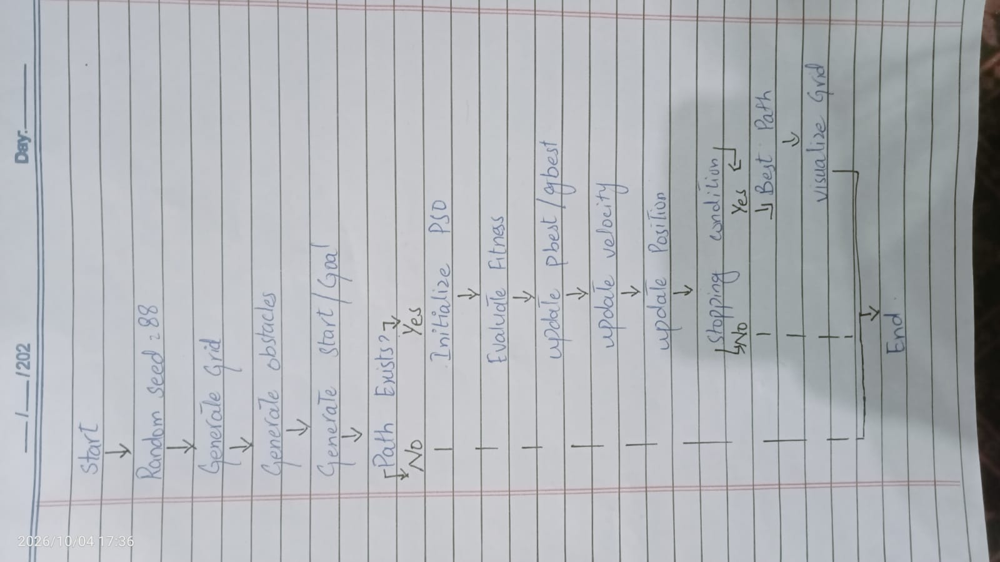

# PSO 2D Grid Path Planning

## Student Information

* **Name:** YOUR NAME
* **Enrollment/Roll Number:** 88
* **Random Seed:** 88

## Project Description

This project implements Particle Swarm Optimization (PSO) for finding a short and obstacle-free path between a randomly generated start point and goal point on a two-dimensional grid.

The problem instance is generated programmatically using the student's enrollment number as the random seed. Therefore, changing the seed produces a different grid, obstacle configuration, start point, and goal point.

## Objective

The objective is to use PSO to find a path from the start point to the goal point while:

1. Avoiding all blocked cells.
2. Minimizing the path length.
3. Producing a visual representation of the final solution.

## Problem Generation

The enrollment number `88` is used as the random seed.

```python
SEED = 88
```

The grid size is generated programmatically from the seed. Obstacles are also randomly generated, and the start and goal points are selected from free cells.

The generated problem is checked to ensure that a valid path between the start and goal exists.

## PSO Approach

Each particle represents a candidate path using a set of intermediate waypoints.

The main steps are:

1. Generate the grid.
2. Generate random obstacles.
3. Generate free start and goal points.
4. Initialize the particle swarm.
5. Generate candidate waypoint paths.
6. Evaluate each candidate using a fitness function.
7. Update each particle's personal best.
8. Update the global best.
9. Update particle velocity and position.
10. Repeat until the maximum number of iterations is reached.
11. Simplify the final path.
12. Visualize the result.

## Fitness Function

The fitness function minimizes both path length and obstacle collisions.

$$
Cost = PathLength + 1000 \times CollisionCount
$$

A large penalty is assigned to paths that pass through obstacles. Therefore, a collision-free path is strongly preferred.

## PSO Update

Particle velocity is updated using:

$$
v_i(t+1)=wv_i(t)+c_1r_1(pbest_i-x_i)
+c_2r_2(gbest-x_i)
$$

The particle position is then updated using:

$$
x_i(t+1)=x_i(t)+v_i(t+1)
$$

## Flow Diagram

The hand-drawn flow diagram used for this project is shown below.



## Visualization

The program generates a visualization containing:

* Grid cells
* Obstacles
* Start point
* Goal point
* PSO-generated path

The final visualization is saved in:

```text
output/best_path.png
```

## Installation

Install Python dependencies using:

```bash
pip install -r requirements.txt
```

## How to Run

Run the main Python program:

```bash
python pso_pathplanning.py
```

The program prints:

* Random seed
* Grid size
* Number of obstacles
* Start point
* Goal point
* PSO iteration results
* Final path length
* Number of obstacle collisions
* Best path

A visualization is also generated automatically.

## Repository Structure

```text
swarm-pathplanning-88/
│
├── pso_pathplanning.py
├── README.md
├── requirements.txt
├── flow_diagram.jpg
│
└── output/
    └── best_path.png
```

## Result

The final solution should have:

* A valid path from start to goal.
* Zero obstacle collisions.
* A minimized path cost.
* A visualization of the resulting path.

## Technologies

* Python
* NumPy
* Matplotlib
* Particle Swarm Optimization (PSO)

## Conclusion

Particle Swarm Optimization was used to search for an efficient path through a randomly generated two-dimensional environment. Using enrollment number `88` as the random seed makes the problem instance unique and reproducible.
